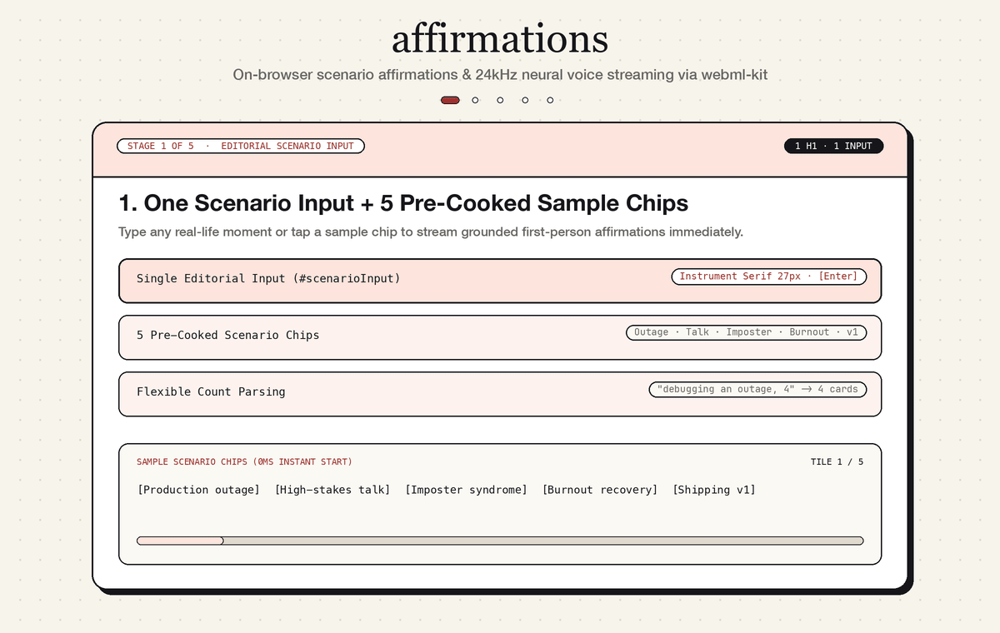

# affirmations

Science-backed affirmations with on-device LLM streaming and 24kHz Kokoro-82M neural voice synthesis.



```bash
npx serve .
```

## Quick start

```js
import localfirst, { detect } from '@ondevice/localfirst';
import fit from 'browser-llm-fit';
import { ModelClient } from 'webml-kit';

const telemetry = await detect();
const isMobile = !telemetry.gpu.webgpu || telemetry.memory.totalGb <= 4;
const modelId = isMobile
  ? 'HuggingFaceTB/SmolLM2-135M-Instruct'
  : 'onnx-community/Qwen2.5-0.5B-Instruct';

const llm = new ModelClient('./model-worker.js');
await llm.load({ task: 'text-generation', modelId, device: isMobile ? 'wasm' : 'webgpu', dtype: 'q4' });

for await (const { token } of llm.stream(messages, { maxNewTokens: 28, doSample: false })) {
  renderCard(token);
}
```

`detect()` probes WebGPU, RAM, and Wasm SIMD in under 2ms. `fit()` checks model hardware bounds. `ModelClient` streams tokens and 24kHz neural audio from an isolated Web Worker.

## Hardware-aware model selection

```js
const check = await fit('smollm2-135m-instruct', {
  ram: telemetry.memory.totalGb,
  gpu: telemetry.gpu.webgpu ? 'webgpu-f16' : 'wasm-cpu'
});

const ai = await localfirst({
  mode: 'prefer-local',
  local: { llm, tts }
});
```

Selects `SmolLM2-135M` (92MB `q4`) on mobile and WASM devices, `SmolLM2-360M` (240MB `q4`) on 4–6GB systems, and `Qwen2.5-0.5B` (350MB `q4`) on desktop WebGPU, stepping down automatically on allocation errors.

## On-device Kokoro-82M neural TTS

```js
const tts = new ModelClient('./model-worker.js');
await tts.load({
  task: 'text-to-speech',
  modelId: 'onnx-community/Kokoro-82M-v1.0-ONNX',
  dtype: 'q8',
  device: 'wasm'
});

const { audio, sampling_rate } = await tts.run('text-to-speech', sentence, {
  voice: 'af_heart',
  speed: 1.0
});
```

Synthesizes 24kHz `Float32Array` audio per clause as each affirmation finishes streaming, with `1×..99×` and `∞` loop playback over Web Audio API.

## Science lenses

- `Attentional Control · dlPFC Focus` — selective attention and working-memory gating
- `Arousal Reappraisal · Crum et al.` — reframing physiological arousal as cognitive readiness
- `Self-Affirmation · Steele & Cascio vmPFC` — anchoring worth in core values over single outcomes
- `Cognitive Defusion · ACT` — separating transient urgency from self-identity
- `Autonomic Regulation · Vagal Brake` — slow exhalation and parasympathetic pacing
- `Implementation Intention · Gollwitzer` — shrinking friction to the next verifiable action
- `Neuroplastic Error Learning · Dweck` — treating bugs and obstacles as diagnostic signal
- `Working-Memory Protection · Cognitive Load` — protecting unfragmented focus
- `Self-Distancing · Kross & Neff` — objective, compassionate internal dialogue
- `Zeigarnik Closure · Bounded Progress` — honoring bounded daily effort

## Demo

- Live: [https://h3manth.com/ai/affirmations/](https://h3manth.com/ai/affirmations/)

## Related

- [@ondevice/localfirst](https://github.com/hemanth/localfirst)
- [browser-llm-fit](https://github.com/hemanth/browser-llm-fit)
- [webml-kit](https://github.com/hemanth/webml-kit)

## License

MIT © [Hemanth.HM](https://h3manth.com)
